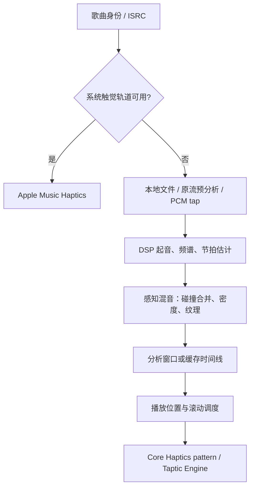

# iOS 音乐震动：节拍审查、研究与实施方案

日期：2026-10-19。审查代码：`f9a94e93a1abc94b30cc4c05804f2e3406502588`；当前触觉算法版本：`auralis-haptics-v3.0`。

本次交付是代码审查与实施设计。没有修改生产算法，没有把源码推断当作本次 iPhone 实测结果。执行环境为 Linux，未运行 Swift/Xcode 或 Taptic Engine 测试。

## 1. 建议与目标

先实现“听得见的节奏，摸得到的主次”：保住歌曲的主要脉冲、底鼓和军鼓，保留原曲的切分与微小时间变化，让持续纹理为节奏留出空间，再改善预测与复杂节奏识别。

现有实现已有节拍跟踪、频谱分析、鼓点分类、触感塑形、密度与疲劳控制；缺口集中在**节拍信息如何变成稳定而清晰的输出**。优先做事件语义、节拍保留、纹理让位、时钟验证与可调体验，随后升级跟踪算法。

产品目标有三层：

1. 能跟拍：主要节奏连续、同步、容易辨认。
2. 像这首歌：有鼓点音色、强弱、切分、段落和停顿。
3. 愿意长期开：舒适、可控、稳定，听完多首也不想关掉。

## 2. 现有链路与代码证据

系统轨道与本地生成是两条不同路径。本地算法升级只影响后者；排查时必须先记录当前真正采用的路径。

以下链接固定到本次审查提交，便于后续对照。

| 发现 | 代码事实与影响 | 建议优先级 |
| --- | --- | --- |
| 节拍主要是起音的附加属性 | [BeatTracker](https://github.com/zyk1172/Auralis/blob/f9a94e93a1abc94b30cc4c05804f2e3406502588/Packages/AuralisCore/Sources/MusicHaptics/MusicHapticsPerceptualMixer.swift#L86) 的 `promoted = candidate && confidence >= 0.45 && onGrid`；[DSP](https://github.com/zyk1172/Auralis/blob/f9a94e93a1abc94b30cc4c05804f2e3406502588/Packages/AuralisCore/Sources/MusicHaptics/MusicHapticsDSP.swift#L398) 按 `isTransient || beat.isBeat` 产出攻击。`nextBeatTime` 只进入估计和诊断，没有独立节拍生成器。弱拍没有跨过起音门槛时，知道 BPM 也不会因此输出该拍。 | P0：先保住真实起音支持的主拍；预测补拍放第二阶段 |
| 节拍身份没有随事件保存 | [MusicHapticsEvent](https://github.com/zyk1172/Auralis/blob/f9a94e93a1abc94b30cc4c05804f2e3406502588/Packages/AuralisCore/Sources/MusicHaptics/MusicHapticsTypes.swift#L297) 保存乐器类别、强度、曲线，没有逐事件 beat ID、节奏角色、观测/预测来源和置信度。混音后的缓存与输出无法可靠区分主拍与装饰音。 | P0：贯穿数据模型、混音、缓存和输出 |
| 碰撞合并可能丢掉节拍信息 | [mergedFrame](https://github.com/zyk1172/Auralis/blob/f9a94e93a1abc94b30cc4c05804f2e3406502588/Packages/AuralisCore/Sources/MusicHaptics/MusicHapticsPerceptualMixer.swift#L973) 使用后一个 frame 的 `beat`。同一碰撞簇里，较晚的非拍点候选可能覆盖较早候选的拍点属性。另一个 [score](https://github.com/zyk1172/Auralis/blob/f9a94e93a1abc94b30cc4c05804f2e3406502588/Packages/AuralisCore/Sources/MusicHaptics/MusicHapticsPerceptualMixer.swift#L1139) 给该簇所有候选加相同 beatPriority，无法改变候选之间的排序。 | P0：候选携带自己的节拍证据，融合保留被支持的节奏身份 |
| 密度预算可能牺牲普通拍 | [密度控制](https://github.com/zyk1172/Auralis/blob/f9a94e93a1abc94b30cc4c05804f2e3406502588/Packages/AuralisCore/Sources/MusicHaptics/MusicHapticsPerceptualMixer.swift#L1153) 超预算后，普通拍还需类别非 unknown 且强度至少 0.62 才受保护。低能量处预算可接近 0.8 次/秒，120 BPM 主拍需要 2 次/秒；弱普通拍存在被压掉的路径。具体歌曲影响待事件追踪验证。 | P0：节奏主干和装饰音分预算；保留全局舒适度上限 |
| “强拍”尚不代表小节第一拍 | [强弱判定](https://github.com/zyk1172/Auralis/blob/f9a94e93a1abc94b30cc4c05804f2e3406502588/Packages/AuralisCore/Sources/MusicHaptics/MusicHapticsPerceptualMixer.swift#L159) 比较最近起音 RMS 中位数，表达相对响度重音，没有拍号、小节位置或 downbeat 模型。 | P1：先明确 loudness accent 语义，避免强行每四拍加重 |
| 跟踪器更擅长规则起音 | [周期估计](https://github.com/zyk1172/Auralis/blob/f9a94e93a1abc94b30cc4c05804f2e3406502588/Packages/AuralisCore/Sources/MusicHaptics/MusicHapticsPerceptualMixer.swift#L104) 从相邻起音间隔及半/倍速推断 55–200 BPM。切分、三连音、swing、弱拍和速度变化需要更丰富的周期证据。置信度由历史间隔计算，缺少独立的无起音超时衰减；当前不会因此自动补拍，但未来接入预测前必须解决。 | P1：多候选周期、相位、证据超时与状态机 |
| 纹理与鼓点虽隔离参数，仍共用一个执行器 | [PatternComposer](https://github.com/zyk1172/Auralis/blob/f9a94e93a1abc94b30cc4c05804f2e3406502588/Packages/AuralisCore/Sources/MusicHaptics/MusicHapticsPatternComposer.swift#L24) 已拆开纹理曲线与攻击，也已给部分鼓点补短连续 body。此处不是“鼓点完全没输出”。但现有 [consumeTexture](https://github.com/zyk1172/Auralis/blob/f9a94e93a1abc94b30cc4c05804f2e3406502588/Packages/AuralisCore/Sources/MusicHaptics/MusicHapticsPerceptualMixer.swift#L1068) 没有按逐拍攻击给纹理让位的侧链包络。参数隔离不能证明触感上没有掩蔽。 | P0/P1：对比“关闭纹理”与“拍点附近纹理减弱”，真机确定效果 |
| 调度已有漂移处理，但尚无物理同步证据 | [调度器](https://github.com/zyk1172/Auralis/blob/f9a94e93a1abc94b30cc4c05804f2e3406502588/Packages/AuralisCore/Sources/MusicHaptics/RollingMusicHapticsScheduler.swift#L244) 的 30/80 ms 是播放位置与 uptime 的误差护栏；[输出](https://github.com/zyk1172/Auralis/blob/f9a94e93a1abc94b30cc4c05804f2e3406502588/Packages/AuralisCore/Sources/MusicHaptics/MusicHapticsRuntime.swift#L608) 以 engine.currentTime + 5 ms 启动。AVPlayer [周期回调](https://github.com/zyk1172/Auralis/blob/f9a94e93a1abc94b30cc4c05804f2e3406502588/Packages/AuralisCore/Sources/PlaybackEngine/AVFoundationPlaybackEngine.swift#L1013) 为 250 ms，窗口到达时可能采用较早的位置。窗口异步到达、主线程负载和音频路由需要测量。250 ms 不是已测得的触觉延迟，漂移诊断也不是皮肤与声音的实测误差。 | P0：增加同一时刻的时间锚与输出确认 |
| 强度枚举尚未形成完整用户控制 | 数据层已有 light/medium/strong；[实时输出](https://github.com/zyk1172/Auralis/blob/f9a94e93a1abc94b30cc4c05804f2e3406502588/Packages/AuralisCore/Sources/MusicHaptics/MusicHapticsRuntime.swift#L2940)、[滚动输出](https://github.com/zyk1172/Auralis/blob/f9a94e93a1abc94b30cc4c05804f2e3406502588/Packages/AuralisCore/Sources/MusicHaptics/MusicHapticsRuntime.swift#L3225) 及完整时间线播放使用 `.medium`。[设置](https://github.com/zyk1172/Auralis/blob/f9a94e93a1abc94b30cc4c05804f2e3406502588/Packages/AuralisCore/Sources/AppShell/SettingsDetailPages.swift#L121) 主要提供开关、系统状态、缓存信息。 | P0：接通轻/中/强和节奏/沉浸选择 |
| 系统可用性与正在播放需区分 | [Adapter](https://github.com/zyk1172/Auralis/blob/f9a94e93a1abc94b30cc4c05804f2e3406502588/Packages/AuralisCore/Sources/MusicHaptics/MusicHapticsRuntime.swift#L401) 查询系统开关与 ISRC 可用性；[resolver](https://github.com/zyk1172/Auralis/blob/f9a94e93a1abc94b30cc4c05804f2e3406502588/Packages/AuralisCore/Sources/MusicHaptics/MusicHapticsRuntime.swift#L360) 优先系统轨道。需加入针对当前歌曲的实际播放状态观察，才能说明某次体验来自哪条链路。 | P0：诊断与仲裁，不与系统叠加播放 |

这些是可检查的实现事实和风险路径，不能据此断言用户那次体验只有一个原因。第一步应拿到同一段音乐“输入拍点 → 混音后 → 实际提交 → 硬件感知”的对应关系。

已有测试覆盖规则 120 BPM、不规则起音、错误初始周期重捕获、70/140 BPM 稳定性、碰撞、攻击定位、纹理参数隔离、时钟漂移与 seek/resume。尚缺按风格标注的音乐语料、逐拍保留率、复杂拍型与真机偏好验证；不能把现有单元测试通过解释为律动已经令人满意。

## 3. 研究依据及其适用边界

| 原始来源 | 支持的结论 | 对本项目的含义与边界 |
| --- | --- | --- |
| Aker 等，2022，[Effect of audio-tactile congruence on vibrotactile music enhancement](https://pubmed.ncbi.nlm.nih.gov/36586853/) | 简单旋律与指间执行器实验中，时间错位、强度不一致对偏好影响最大。 | 先优化同步和动态一致性。不能据此直接指定 iPhone 的最佳延迟、频率或强度。 |
| Siedenburg 等，2024，[Vibrotactile enhancement of musical engagement](https://www.nature.com/articles/s41598-024-57961-8) | 41 名参与者通过耳机和震动座椅体验音乐；匹配的震动改善体验，突出维度包括参与感、唤醒和 groove。 | 评价应包含“想跟着动”和“融入音乐”，而非只问震不震。座椅的多接触面与手机单执行器不同。 |
| Tranchant 等，2017，[Feeling the Beat](https://pubmed.ncbi.nlm.nih.gov/28955193/) | 7 名早期失聪者、14 名听力正常者可跟随震动平台上的 EDM 节奏运动；听力正常组的音频同步表现更好。 | 支持“可触摸的节奏”具有可访问性价值；不代表手机已能达到平台的效果。 |
| Aker 等，2024，[Some, but not all, cochlear implant users prefer music stimuli with congruent haptic stimulation](https://orbit.dtu.dk/en/publications/some-but-not-all-cochlear-implant-users-prefer-music-stimuli-with/) | 18 名人工耳蜗使用者与 24 名听力正常者对映射的偏好有个体差异，部分 CI 使用者更喜欢时间、强度匹配。 | 单一默认设置无法满足所有人；需保留可关闭、强度选择与分组评估。不能许诺医疗或听力改善。 |
| Apple，[Playing haptics](https://developer.apple.com/design/human-interface-guidelines/playing-haptics) 与 [Core Haptics](https://developer.apple.com/documentation/corehaptics) | 瞬态、持续事件、强度和 sharpness 可构成不同触感。 | sharpness 用于软硬、圆润/清脆的差异，不等同于任意设置马达振动频率或重现音高。 |
| Apple，[Music Haptics API](https://developer.apple.com/documentation/mediaaccessibility/music-haptics)、[MAMusicHapticsManager](https://developer.apple.com/documentation/mediaaccessibility/mamusichapticsmanager)、[用户指南](https://support.apple.com/en-nz/guide/iphone/iphff2ceeb16/ios) | 系统路径关联 ISRC，可观察实际播放；当前指南包含 Full Mix、Vocals Only 与轻/中/强。 | 保留系统支持；系统功能存在不代表第三方 API 可让应用修改其算法或强度。设置界面应明确控制的来源和范围。 |
| librosa，[beat_track](https://librosa.org/doc/main/api/generated/librosa.beat.beat_track.html) | 起音强度、周期估计、动态规划选拍组成成熟的工程基线。 | 用于离线对照和自研 Swift 路线参考，不能把完整离线算法无条件搬入实时回调。 |
| Essentia，[BeatTrackerMultiFeature](https://essentia.upf.edu/reference/std_BeatTrackerMultiFeature.html) | 多个起音函数给出候选，再按一致性选择拍点，并输出置信度。 | 支持采用多频带/多候选。该实现要求 44.1 kHz，置信度量程与本项目不同，不能直接照搬 0.45 阈值；集成库和模型前单独检查许可与开销。 |

上述研究为设计排序提供依据，不能替代 Auralis 用户研究。目前没有本产品“哪些维度最受欢迎”的使用数据；以下维度是需要验证的产品假设。

## 4. 真正值得使用的体验维度

| 维度 | 用户能说清的价值 | 设计落实 | 验证问题 |
| --- | --- | --- | --- |
| 同步与可信度（最高优先） | “这一震就是这一拍。” | 声音与触觉对齐；暂停、切歌立即停止；不把过期事件补成一串。 | 能否察觉提前/滞后？切歌后有没有上一首的震动？ |
| 脉冲与律动层次 | “闭眼也能跟上，切分仍像原曲。” | 主拍清楚，底鼓/军鼓有区别，装饰音有选择；保留 swing 与演奏时差。 | 是否更容易跟拍、更想随音乐动？ |
| 音乐表现力 | “主歌轻，副歌更有冲击，停顿也能感到。” | 相对动态、攻击/延音和段落变化；留出峰值空间，避免拍拍满强度。 | 用户能否辨认段落变化？不同歌曲是否有不同触感？ |
| 清晰与留白 | “鼓点是一下一下的，不是一片嗡嗡声。” | 攻击附近纹理减弱；减少高频密集装饰，静音时不生成节拍。 | 纹理开关前后主拍辨认是否受损？静默是否安静？ |
| 舒适与掌控 | “能听很久，力度由我决定。” | 强度独立于节奏密度；轻档仍完整表达主要节奏；一键停用、记住选择。 | 连续 20–30 分钟后是否疲劳、麻烦或想关闭？ |
| 可访问性与个体适配 | “不依赖完整听觉也能参与音乐。” | 听力正常、D/HoH、CI 使用者分组测试；不以单组均值代表所有人；功能和状态可被 VoiceOver 理解。 | 各组能否感知主要结构？是否出现截然不同的偏好？ |
| 日常可靠性与成本 | “锁屏听歌也管用，不影响播放。” | 前后台连续、耳机路由恢复、低功耗降级、缓存复用；异常说明可理解。 | 一周后是否仍主动使用？电量、发热、音频流畅度是否可接受？ |

先提供少量明确选择：本地触觉的“节奏清晰 / 音乐沉浸”两种风格，以及独立的轻/中/强。前者弱化纹理、突出节奏；后者保留纹理但不遮住主拍。轻档降低幅度、质感和装饰音负担，主要节奏不因选择轻档而随机消失。

设置里提供可随时停止的短预览和“恢复默认”；播放页只保留快速开关。全局设置与既有逐曲开关继承关系一致。系统轨道工作时显示“由系统 Music Haptics 提供”，说明本地风格设置的作用范围。先不增加十几个声学参数滑杆；逐曲风格覆盖、简易同步校准可在用户试用后决定是否进入下一版。

## 5. 音乐与算法结合的设计

### 5.1 先把事件语义打通

为每个候选与最终事件增加可选音乐元数据：`rhythmicRole`（pulse / accent / ornament / texture）、`beatID`、`beatConfidence`、`onsetConfidence`、`evidence`（observed / predicted）、必要的 grid segment ID。乐器分类继续表示音色，不能代替节奏角色；一个军鼓既可能在主拍，也可能是切分装饰。

元数据贯穿 DSP、候选融合、去重、时间线、checkpoint、切片、PatternComposer 与输出结果。合并真实起音和同一拍预测事件时只保留一击，并记录双方证据；不同时间的切分不能因同属一个 beat ID 被直接删除。当前 `strongBeat` 的响度重音与未来 downbeat 分字段。

缓存加入分段节拍信息和完整版本策略；改变事件选择或时间语义时升级算法版本，旧缓存重新分析。保持旧 JSON 可读，但不能把缺少节拍语义的旧缓存直接视为新版本高质量结果。强度/风格尽可能在渲染阶段应用，避免用户每换档就重新分析整首歌。

### 5.2 建立“节奏主干 + 音乐细节 + 纹理”混音

节奏主干优先保留高可信、真实起音支持的拍点/重要切分；装饰音使用剩余预算。疲劳控制优先降低持续纹理占空、装饰密度和总幅度，再平滑调整脉冲策略。保留硬件资源上限；优先级不表示任何情况下无限输出。

碰撞解决依照逐事件的时间、角色、证据强度和音色，不再给同簇所有候选加相同节拍常数。真实底鼓与对应主拍融合；底鼓和近邻军鼓是否融合需对比原曲时间结构。当前 70 ms 碰撞窗只作为基线，按事件类别和速度试验更精细窗口，避免吞掉快速 flam 或短切分。

使用攻击事件驱动的纹理减弱包络，为瞬态留出触感对比。预分析允许提前塑形；实时路径只能在可用证据范围内及时减弱，不能为追求提前让位而阻塞音频。起始参数可试攻击前 10–20 ms、后 40–80 ms 的减弱/恢复，**这些是实验范围，不是已证实最佳值**。需同时统计鼓点 body 与纹理造成的总持续负担。

底鼓用圆润短击加已有短 body；军鼓偏清脆；高频打击更轻且稀疏。通过强度、sharpness、包络和时值映射音乐层次，不能承诺一台手机可同时清楚重现所有乐器或旋律音高。

### 5.3 升级跟踪器，而不是增加固定节拍器

保留已有 22.05 kHz、1024/256 FFT 与起音定位作为可回退基线：一帧约 46.4 ms，hop 约 11.6 ms；这些是分析分辨率，不是端到端延迟。现有频带、flux 和起音定位继续复用。

1. 为低频打击、中频攻击、高频打击建立归一化起音强度序列，使用频谱白化/局部归一化候选降低响度母带与高帽密度的干扰。对照当前全频 onset，不预设新特征必然更好。
2. 在有界历史中计算周期相关/局部 tempogram，保留数个 BPM 与相位候选；采用小型 beam/动态规划或多假设相位跟踪，综合起音支持、相位误差、节奏稳定性和倍/半速歧义。
3. 使用 `acquiring → locked → uncertain → silent` 状态；置信度包含距最近证据时间，不能仅由旧间隔列表维持。静音、seek、断流、明显段落或速度变化使预测失效/重捕获。
4. 本地/原流预分析可用有限未来上下文修正尚未提交的拍点；PCM 实时降级只处理实际可获得的过去。两者采用同一事件语义，记录不同可用性，绝不为了分析等待音频。
5. 预测补拍先做实验选项：仅在连续多拍稳定、音乐能量仍存在、拍点证据足够时，短期补一个较轻脉冲；随后缺证据即衰减停止。已分析未来明确没有拍点/音乐停顿时，不补；不在静默、rubato、自由节奏中继续节拍器。
6. 不把 4/4 固定为所有歌曲的拍号。3/4、6/8、swing、切分和复合拍均做专项；未可靠识别小节位置时只表达真实响度重音与主脉冲。downbeat/拍号模型在独立证明有效后再接入。

例如 120 BPM 的普通 4/4 片段：0、0.5、1、1.5 秒可感到主要脉冲，真实底鼓/军鼓附着其中；0.25、0.75 秒高帽作为更轻的细节。这个例子说明层级，不能作为所有歌曲模板。真实攻击保留其时间，不能为了网格把演奏强行量化；同拍预测与观测按容差合并，容差也随速度验证。

首选自研 Swift 轻量方案，使用 librosa/Essentia 做离线参考，不把参考工具输出当人工真值。只有困难语料的改善不足时，再评估 Core ML beat/downbeat 模型；比较识别增益、CPU、内存、模型体积、首次加载、低功耗表现与许可。第一版无需云端模型或整曲上传。

### 5.4 让调度对真实的音乐时钟负责

新增播放时间锚，至少包含歌曲 position、单调时钟采样时刻、rate、generation、route generation、playing/buffering 状态。在输出提交时估算“现在的歌曲位置”，必要时重新采样 AVPlayer；测量跨线程交付耗时，不把 UI tick 当事件精确定时器。

Core Haptics 事件继续按绝对引擎时刻与相对事件时间批量提交；不创建每拍 Timer。所有同批 player 共用同一启动锚。Apple 的 [engine.currentTime](https://developer.apple.com/documentation/corehaptics/chhapticengine/currenttime) 是触觉引擎时间，不能直接与 AVPlayer 歌曲秒数当成同一时钟。

音频输出延迟信息用于诊断和测量建模。AVPlayer、蓝牙和扬声器可能已有不同时间补偿，不能统一把 `AVAudioSession.outputLatency` 再加一次。按实际听到的声音与设备表面振动验证偏差方向，分别测量扬声器、有线耳机、AirPods/蓝牙；路由切换、变速、seek、暂停、引擎 reset 重新建锚。

把输出改成可报告结果的契约：submitted / filtered / stale / capacityRejected / engineStopped，附事件角色、计数与时间范围。调度器不得把 engine 拒绝的窗口算成已成功震动；重试仅限仍在未来且不会重复的事件。实际物理输出需外部测量，软件 submitted 不能冒充 delivered。

当前 2.5–4 秒提交 horizon 保持为基线；可变速/变拍时冻结已提交区域，修正其后的事件，必要时按 generation 清空重建。后续按同步数据决定是否缩短 horizon，不能靠频繁全停来消除漂移。

### 5.5 系统与本地输出仲裁

接入系统 active 状态变化与按歌曲区分的实际 haptic playback observer；UI/诊断区分“功能开着”“有轨道”“该轨道正在播放”。系统接管时停止本地，不能把自研拍点叠加到系统轨道上。

系统轨道可用但暂未播放时，需研究实际回调时序和公开 API 能力，设计有滞回的恢复策略；不因一次 false 状态立刻并行启动本地。若无法可靠证明互斥，先明确显示来源状态并安全停止本地。应用不能假设能逐曲关闭或修改系统轨道来强制本地风格。

## 6. 分阶段实施与交付

| 阶段 | 修改范围 | 具体交付和完成条件 |
| --- | --- | --- |
| A：诊断与基线 | Runtime、RollingScheduler、PlaybackEngine、调试页、测试工具 | 同段音乐记录起音/拍点候选、合并/密度/阈值丢弃原因、实际提交、引擎拒绝、系统来源和时间锚。生成可对齐的事件轨迹；至少复现一段用户所说“有震动但没节拍”的片段，并判明主要损失阶段。 |
| B：清晰节奏第一版 | Types、DSP 元数据、PerceptualMixer、PatternComposer、Store/PlaybackPlan、设置与播放输出 | 修复逐候选身份与跨帧覆盖；节奏主干单独保留；纹理让位；接通两种风格和三档强度；版本化缓存。先基于真实起音，不依赖预测补拍。通过有拍点标注的回归和 iPhone 短试听。 |
| C：跟踪和同步升级 | BeatTracker 可拆成独立文件、DSP、预分析/实时适配、Runtime 时钟和仲裁 | 多候选周期/相位、置信度超时、缺拍/速度变化处理；精确提交锚；预测补拍默认关闭，只有盲测和静默/断流回归通过才启用。按曲风报告增益和退化。 |
| D：体验验收与发布 | iPhone 实验、回归、设置默认值、灰度/回退 | 确认同步、groove、舒适性、持续使用意愿与资源成本；最终默认风格由试用决定。独立算法开关和缓存版本可回退；未改善的风格保持旧策略或降级。 |

各阶段以可观察结果验收，不把“新增检测函数”“测试能调用”作为完成标准。先完成 A/B 形成能试听的变化，C 的算法复杂度由困难样例决定。

## 7. 验证设计与验收指标

### 7.1 语料与软件回归

建立有授权的 40–60 段、每段 20–45 秒语料，至少包含流行、EDM、摇滚、嘻哈、爵士 swing、3/4、6/8、原声/古典 rubato、环境音乐、静默与说话。覆盖低响度、限幅母带、强 bass 弱鼓、密集高帽、切分、突然变速与无鼓节奏。选取适用的公开标注作参考，两位标注者独立标注并记录分歧/多种合理拍速，不把一种 BPM 当作唯一正确感知。

保留原始拍点和原曲演奏偏移；以整首/来源分开调参集与保留测试集。合成 click、底鼓、军鼓、掉拍、噪声用于确定性边界测试，不能代替真实音乐。既有测试继续保留，并补充：

- 主拍候选与稍后非拍候选碰撞，身份不丢失；同拍预测与真实起音只输出一次。
- 120 BPM 弱普通拍在装饰音超预算时仍保留；轻档不会因统一阈值破坏主脉冲。
- swing、三连音、3/4、6/8、半/倍速、速度渐变、切分、停顿后重入；低置信度无持续补拍。
- 长静默、音频缓冲、seek、切歌、变速、路由/引擎重置后无旧事件；系统/本地不双播。
- 本地、原流预分析、实时降级、热缓存/旧缓存迁移保持节拍语义；容量拒绝不会冒充成功。
- 纹理让位不影响其它 pattern 的动态参数；鼓点 body 不造成第二次明显敲击；总持续负担正确统计。

### 7.2 分开衡量识别、混音、调度和物理效果

以下数字是**候选工程目标，尚未取得本项目测量证据**；阶段 A 确定基线后，可在事先记录理由的情况下调整。不能用同一语料边调边宣称达标。

| 层级 | 指标与初始验收口径 |
| --- | --- |
| 节拍识别 | 报告按风格的 beat F1、CML/AML 连续性、half/double 错误、锁定时间与重捕获时间；F1 可先用 ±70 ms 标准容差，同时报告更严格误差分布。参考结果与人工标注分开。该容差不是允许硬件延迟 70 ms。 |
| 事件保留 | 分别统计人工标注主拍 → 合格 DSP 候选、候选 → 混音输出、混音 → 接受提交，禁止只统计最后一段高比例。高置信度、音乐适用片段中候选到混音主拍保留率目标 ≥95%，错误/多余拍与保留率同时报告。 |
| 预测行为 | 静默/暂停/seek 后陈旧预测事件为 0；按片段报告无依据补拍率。复杂自由节奏允许返回不确定，不强求满拍覆盖。 |
| 软件同步 | 提交时钟误差、排队时间、丢弃原因、重建次数分开记录；软件数值不能代表实际触觉到达。 |
| 物理同步 | 优先用共用采样时钟录制音频输出和设备表面加速度/接触传感器，再算瞬态起点差。逐路由报告有符号偏差、抖动、P50/P95 和异常值；以中位绝对误差 ≤20 ms、P95 ≤40 ms 作为首轮验证目标，蓝牙先报告实测再定路由门槛。手机内部日志或屏幕录像不能替代该测量。 |
| 稳定性与资源 | 无新增音频卡顿/渲染回调阻塞；对照同机同音量同曲目 30 分钟的电量、CPU、内存、温升和低功耗表现。先争取相对现有触觉版本无明显退化，再据实测确定预算。 |

### 7.3 iPhone 用户试用

先做 8–12 人形成性试用排明显问题，再做约 24–30 人的随机顺序、同曲段配对实验；人数是启动规模建议，正式功效分析按试点方差确定。若纳入 D/HoH、CI 使用者，单独招募/报告，不能用总人数掩盖各组样本不足。

对比四种条件：关闭触觉、当前版本、节奏清晰、新沉浸模式。用参与者代号隐藏算法名字，打乱顺序，控制时长、音量与平均可感强度；关闭触觉无法完全盲化，应明确记录。额外做“有/无纹理让位”“仅观测/允许短预测”的消融，分清改善来自哪里。

每段询问同步感、易跟拍程度、想动程度、音乐参与感、舒服程度、干扰程度、总体偏好；可采集自愿 tap 跟拍的时间方差，作为辅助，不用更用力敲代替更喜欢。约 20–30 分钟后再次评价疲劳与关闭意愿。手机握持、有壳、口袋场景分别体验，不把桌面共振当作手持体验。

首轮期望新节奏模式在至少 2/3 的参与者中优于当前版本，且舒适性不下降；这是产品去留门槛提案，不是论文结论或统计显著性的替代。报告个体分布、置信区间与失败曲风。可选的一周本地试用观察主动开启、完整听完、主动关闭的原因；只在用户同意后导出，不新增默认上传音乐/行为的服务。

真机回归至少覆盖支持 Core Haptics 的较早与较新两代 iPhone、最低支持 iOS 与当前稳定 iOS，扬声器/有线/蓝牙、本地/远程、锁屏/后台、低功耗、来电/音频中断与恢复。后台延续遵循现有 [TestingStrategy](TestingStrategy.md)；系统实际暂停触觉时显示状态并在可用时恢复，不承诺平台不允许的永久后台执行。

## 8. 第一批应实现的事项

1. 增加逐事件节拍元数据与输出结果追踪，建立可复现试听片段。
2. 修复碰撞后的拍点身份与候选优先级，给真实主拍独立预算。
3. 实现纹理让位，对比关闭纹理的清晰度基线。
4. 接通本地两种风格与轻/中/强；说明系统来源，保持逐曲开关继承。
5. 加入新旧缓存、静默、跨帧、快速切歌和逐拍保留回归，完成 iPhone 实测后再决定多候选跟踪与预测补拍的默认策略。

第一版应让用户明确感到主节奏更清晰、强弱更像音乐、长期听更舒服。随后再用困难曲目和试用数据决定算法应深入到哪一层。
